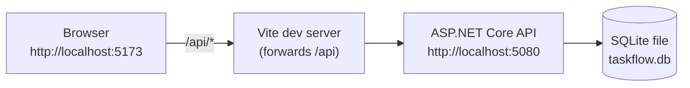

# TaskFlow

A small, single-user task manager: organize tasks into projects, track status, priority and due dates.
Built as a beginner-friendly portfolio project with an ASP.NET Core Web API and a React + TypeScript frontend.

## Prerequisites

- [.NET 10 SDK](https://dotnet.microsoft.com/download)
- [Node.js](https://nodejs.org/) 22.22 or later (24 LTS recommended)

## Run it locally

Start the API (first terminal):

```bash
cd backend && dotnet run --project TaskFlow.Api      # API on http://localhost:5080, Swagger at /swagger
```

Start the frontend (second terminal):

```bash
cd frontend && npm install && npm run dev            # app on http://localhost:5173
```

Open <http://localhost:5173>. The Dashboard shows **API connected** when the frontend can reach the API.
Swagger UI (Development only) is at <http://localhost:5080/swagger>.

## Test and build

```bash
(cd backend && dotnet test)                          # backend tests
(cd frontend && npm run build)                       # type-check + production build
```

## Dependencies added beyond the templates

The projects were created from the standard `dotnet new webapi`, `dotnet new xunit` and `create-vite` (`react-ts`) templates. Only these packages were added, each for a specific reason:

| Package | Version | Why |
| --- | --- | --- |
| Swashbuckle.AspNetCore.SwaggerUI | 10.3.1 | .NET 10 generates the OpenAPI document (`/openapi/v1.json`) but has no page to browse it. This UI-only package serves the Swagger page at `/swagger`. |
| Microsoft.AspNetCore.Mvc.Testing | 10.0.11 | Provides `WebApplicationFactory`, which starts the real API in memory so tests can call it over HTTP. |
| react-router | 8.5.x | Real URLs for each page and a working back button. Imported from `react-router` (not `react-router-dom`, which stops at v7). |

All Microsoft packages are pinned to 10.0.11, matching the .NET 10 runtime. The repo-local tool manifest (`.config/dotnet-tools.json`) also pins `dotnet-ef` 10.0.11 for creating database migrations in a later story.

## How TaskFlow is built

This section describes the target design; features land story by story (see [`_bmad-output/planning-artifacts/epics.md`](_bmad-output/planning-artifacts/epics.md)).

TaskFlow is a small full-stack app with two parts that run side by side on your machine:

- **Backend:** an ASP.NET Core Web API in C# (.NET 10). It owns all the data and every rule.
- **Frontend:** a React + TypeScript app built with Vite. It shows the data and sends what you type to the API.



The browser only ever talks to the Vite dev server. Vite forwards every `/api/...` request to the API, so there is no cross-origin (CORS) setup and no HTTPS certificate to install.

### Inside the API: three layers

| Layer | What it does | Example |
| --- | --- | --- |
| **Controllers** | Receive HTTP requests and send responses. No rules here. | `TasksController` |
| **Services** | Check every input, apply the business rules, read and write data. | `TaskService` checks that a title is present and that the due date is not in the past |
| **Data** | Describes the tables and relationships for Entity Framework Core. | `TaskFlowDbContext`: deleting a project deletes its tasks |

Requests and responses use small **DTO** classes (data transfer objects), so the database entities never leak into the API.

### Rules the database and API enforce

- Every task belongs to an existing project. Deleting a project deletes its tasks. The **database** enforces this with a foreign-key cascade, not only the C# code.
- Status (`Todo`, `InProgress`, `Done`) and priority (`Low`, `Medium`, `High`) accept only these names, ignoring case. Numbers like `2` or `7` are rejected, both in request bodies and in URL filters.
- A due date can't be set in the past. "Today" comes from an injectable clock (`TimeProvider`), so tests can fix the date.
- Invalid input returns HTTP 400 with one message per field. The form shows each message next to its input.

### How it is tested

`dotnet test` starts the real API in memory and calls it over HTTP. Each test gets a fresh **SQLite in-memory** database, so foreign keys and cascade deletes behave exactly as they do in the real `taskflow.db` file. One extra test writes to a temporary database file, restarts the API, and checks the data is still there.

### Where things live

```text
backend/TaskFlow.Api/         API: Controllers/, Services/, Dtos/, Models/, Data/
backend/TaskFlow.Api.Tests/   xUnit integration tests
frontend/src/                 React: pages/, components/, api/ (the only code that calls the API)
```
