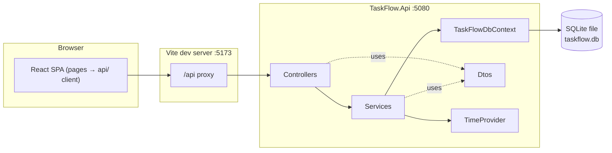
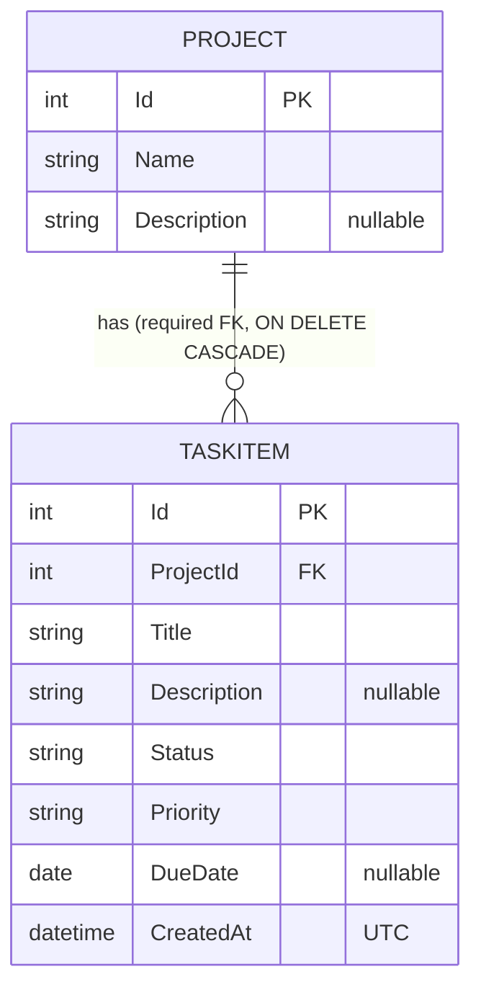

# Architecture Spine — TaskFlow

## Design Paradigm

**Layered monolith API + SPA.** One ASP.NET Core Web API process owns all data and all rules; one React SPA renders it. Inside the API there are three layers, and each one may call only the layer below it.

| Layer | Folder (`backend/TaskFlow.Api/`) | Owns |
| --- | --- | --- |
| HTTP | `Controllers/` | Routes, model binding, turning a `ServiceResult` into an HTTP response. No rules, no `DbContext`. |
| Business | `Services/` | Validation, trimming, defaults, business rules, DTO projection, every EF query. |
| Data | `Data/` (+ `Models/` entities) | `TaskFlowDbContext`, relationship config, migrations. |
| Contracts | `Dtos/` | Request and response types. The only types that cross the HTTP boundary. |



Allowed dependencies: Controllers → Services, Dtos. Services → DbContext, Models, Dtos, TimeProvider. Data → Models. Nothing depends upward. Entities never reach a controller. In the frontend, pages → `src/api/` and components; components never import `src/api/`.

## Invariants & Rules

### AD-1 — Controllers are HTTP-only; services own every rule [ADOPTED]

- **Binds:** all endpoints; FR-1…FR-11; NFR-9
- **Prevents:** rules split between controllers and services; a controller querying the DbContext directly.
- **Rule:** Controllers (`[ApiController]`, attribute routes under `/api/...`) only bind input, call one service method, and translate its result. Services use `TaskFlowDbContext` directly. They are concrete classes registered with `AddScoped` and have no interfaces. Do not add a repository, unit-of-work, AutoMapper or base-controller layer.

### AD-2 — One result shape from services to controllers

- **Binds:** every service method that can fail; FR-2/3/6/7/8 (404), FR-11 (400)
- **Prevents:** each controller inventing its own error-to-HTTP mapping; services throwing exceptions for control flow; the same bad PUT giving 404 in one story and 400 in another.
- **Rule:**
  - `Services/ServiceResult.cs` defines `enum ResultKind { Ok, NotFound, Invalid }` and `ServiceResult<T>`. It has `Kind`, `Value` and `Errors` (`Dictionary<string, string[]>`) plus three static factories: `Ok(value)`, `NotFound()`, `Invalid(errors)`. A non-generic `ServiceResult` covers delete.
  - Each controller action maps the result with an inline `switch` on `Kind`:
    - `Invalid` → `ValidationProblem(new ValidationProblemDetails(result.Errors))` (400)
    - `NotFound` → `NotFound()` (404 ProblemDetails)
    - `Ok` → `Ok(value)` (GET/PUT), `CreatedAtAction(nameof(GetById), new { id }, value)` (POST) or `NoContent()` (DELETE)
  - Controller action names have **no** `Async` suffix, because MVC strips it and `nameof` would then break. Service methods keep `Async`.
  - On PUT and DELETE, an unknown route id is checked first and returns 404 before the body is validated.
  - Exceptions are only for unexpected failures, which surface as 500 ProblemDetails (`AddProblemDetails` + `UseExceptionHandler`).

### AD-3 — Single-pass validation in plain C#, shared by create and update [ADOPTED]

- **Binds:** FR-1, FR-3, FR-5, FR-7, FR-9, FR-11; AC-1, AC-2, AC-3
- **Prevents:** two-pass errors (attributes first, database rules on the next submit); the FR-5 rules copied into separate create and update methods that drift apart.
- **Rule:**
  - Each entity has **one** method that is used by both create and update: `ProjectService.ValidateAndApply(request, project)` and `TaskService.ValidateAndApplyAsync(request, task, isNew)`. It checks every field, including that the project exists and the due-date rule, collects every failure into one error dictionary (at most one message per key), and copies the cleaned values onto the entity only when there are no errors. The caller saves only when the dictionary is empty.
  - For tasks, `isNew` only switches the defaults and the due-date comparison (AD-7, AD-8).
  - Messages come only from the table in **Consistency Conventions**. Length limits are checked after trimming.
  - Use no DataAnnotations *validation* attributes and no FluentValidation. (`[DisplayFormat]` in AD-4 is a binding hint, not a validation rule.)
  - Every request-DTO property is nullable (`string?`, `int?`, `DateOnly?`), so the framework's implicit `[Required]` never runs before the service.
  - The `[FromBody]` action parameter itself stays non-nullable, so an empty body is a 400.
  - `[ApiController]`'s automatic 400 is kept only for JSON the binder cannot read. Example: `"status": 2` gives the keys `$.status` and `request`.

### AD-4 — Status/priority input goes through one shared name parser [ADOPTED]

- **Binds:** FR-5, FR-7, FR-9; AC-3; CLAUDE.md enum convention
- **Prevents:** numeric or undefined enum values getting in through the URL (MVC binding accepts `?status=7`); the body and the query string following different rules; an empty filter being silently ignored.
- **Rule:**
  - `SaveTaskRequest.Status` and `.Priority` are `string?`. One static helper, `Services/EnumNames.TryParse<TEnum>(string? input, out TEnum value)`, accepts a value only when it equals one of `Enum.GetNames<TEnum>()` ignoring case. Everything else fails: numbers, commas, empty strings, surrounding whitespace and misspellings. Never use `Enum.TryParse` or `Enum.IsDefined` on user input.
  - `TaskListQuery` is a **class** with `{ get; set; }` properties, never a positional record (MVC ignores `[DisplayFormat]` there). It is bound with an explicit `[FromQuery]`, because `[ApiController]` would otherwise treat a complex type as coming from the body.
  - `TaskListQuery` has `Status`, `Priority` and `ProjectId`, all `string?`, each with `[DisplayFormat(ConvertEmptyStringToNull = false)]`. A parameter that is left out (null) means "All". An empty value (`?status=`) or an invalid value is a 400.
  - `ProjectId` is parsed in the service with `int.TryParse`, then checked to exist.
  - Output: `JsonStringEnumConverter(allowIntegerValues: false)` is registered globally in `AddControllers().AddJsonOptions`, so responses always send names.
  - Tests: `?status=`, `?status=2`, `?priority=7` and `?projectId=999` each give 400 with the matching key.

### AD-5 — Entity shapes and naming [ADOPTED]

- **Binds:** Models, Dtos, migrations, frontend `types.ts`
- **Prevents:** clashes with `System.Threading.Tasks.Task` and `TaskStatus`; a `NOT NULL` column for an optional field (storing null would then cause a 500); TS types drifting between `?` and `| null`.
- **Rule:**
  - `Project { int Id; string Name; string? Description; List<TaskItem> Tasks }`.
  - `TaskItem { int Id; string Title; string? Description; TaskItemStatus Status; TaskPriority Priority; DateOnly? DueDate; DateTime CreatedAt; int ProjectId; Project Project }`. `Project = null!` is the EF navigation idiom.
  - `TaskItemStatus { Todo, InProgress, Done }` and `TaskPriority { Low, Medium, High }` are stored as text (`HasConversion<string>()`). The JSON wire names are exactly these member names.
  - Do not use `HasMaxLength`: SQLite does not enforce it, and the limits live in AD-3.
  - In `types.ts`, nullable fields are typed `T | null` (never `?`), and enums are string unions built from `as const` arrays: `TASK_STATUSES`, `TASK_PRIORITIES`. Filters and selects render options from those arrays.

### AD-6 — Project → TaskItem cascade is enforced by the database [ADOPTED]

- **Binds:** FR-4, NFR-2; AC-2, AC-5
- **Prevents:** orphaned tasks; a cascade that works only because EF happened to load the tasks.
- **Rule:**
  - In `OnModelCreating`: `HasMany(p => p.Tasks).WithOne(t => t.Project).HasForeignKey(t => t.ProjectId).IsRequired().OnDelete(DeleteBehavior.Cascade)`.
  - `ProjectService.DeleteAsync` removes only the `Project` row (its tasks are not loaded), so the database's `ON DELETE CASCADE` does the work.
  - The AC-5 test deletes the project through the API, then counts `TaskItems` for that project id through a `TaskFlowDbContext` from `factory.Services` and expects 0.

### AD-7 — Dates and "today" [ADOPTED]

- **Binds:** FR-5, FR-6, FR-7; tests
- **Prevents:** time-of-day and time-zone off-by-one bugs; tests that depend on the real clock; SQLite being unable to sort a `DateTimeOffset`; `createdAt` being read as local time.
- **Rule:**
  - `DueDate` is `DateOnly?`, stored as `TEXT yyyy-MM-dd`.
  - Today is `DateOnly.FromDateTime(timeProvider.GetLocalNow().DateTime)`. `TimeProvider.System` is registered as a singleton, and services take `TimeProvider` in their constructor. Nothing calls `DateTime.Now`, `DateTime.UtcNow` or `DateTime.Today`.
  - `CreatedAt` is a UTC `DateTime`, set from `timeProvider.GetUtcNow().UtcDateTime`. Its EF mapping has `.HasConversion(v => v, v => DateTime.SpecifyKind(v, DateTimeKind.Utc))`, so the JSON ends in `Z`. A test asserts that it does.
  - Task lists are ordered by `CreatedAt` descending, then `Id` descending.
  - **Create:** the due date must be null or `>= today`.
  - **Update:** if the due date equals the stored value, it is accepted, even if it is in the past. If it is null, the stored date is cleared. Otherwise it must be `>= today`.

### AD-8 — PUT replaces the whole resource; defaults only on create [ADOPTED]

- **Binds:** FR-3, FR-5, FR-7
- **Prevents:** an edit silently resetting a status or priority to its default.
- **Rule:**
  - `POST` and `PUT /api/tasks` share `SaveTaskRequest`.
  - **Create:** a null status means `Todo` and a null priority means `Medium`. An empty or invalid value is an error.
  - **Update:** title, projectId, status and priority are all required. A null due date clears it.
  - A description that is null or whitespace-only is stored as null.
  - Projects use one `SaveProjectRequest` with the same full-replace meaning.
  - Name, title and description are always stored trimmed.

### AD-9 — API contract and error keys

- **Binds:** backend controllers and frontend `src/api/`
- **Prevents:** the frontend and backend disagreeing on routes, shapes or field keys, which would leave errors unmatched to their inputs.
- **Rule:** The JSON is camelCase. Validation error keys are the camelCase request property names: `name`, `description`, `title`, `projectId`, `status`, `priority`, `dueDate`. The endpoints are exactly the table below. An unknown id in the route is a 404. An unknown `projectId` in a body or in the query string is a 400 under the key `projectId`.

| Method & route | Request | Success |
| --- | --- | --- |
| `GET /api/health` | — | `200` text `Healthy` (built-in health checks) |
| `GET /api/projects` | — | `200 ProjectDto[]` (by name, then id) |
| `GET /api/projects/{id}` | — | `200 ProjectDto` |
| `POST /api/projects` | `SaveProjectRequest { name, description }` | `201 ProjectDto` |
| `PUT /api/projects/{id}` | `SaveProjectRequest` | `200 ProjectDto` |
| `DELETE /api/projects/{id}` | — | `204` |
| `GET /api/tasks?status=&priority=&projectId=` | `[FromQuery] TaskListQuery` | `200 TaskDto[]` |
| `GET /api/tasks/{id}` | — | `200 TaskDto` |
| `POST /api/tasks` | `SaveTaskRequest { title, description, projectId, status, priority, dueDate }` | `201 TaskDto` |
| `PUT /api/tasks/{id}` | `SaveTaskRequest` | `200 TaskDto` |
| `DELETE /api/tasks/{id}` | — | `204` |
| `GET /api/dashboard` | — | `200 DashboardDto { total, completed, pending }` |

`ProjectDto { id, name, description, taskCount }`. `TaskDto { id, title, description, status, priority, dueDate, projectId, projectName, createdAt }`. Every request property is nullable on the wire (AD-3).

### AD-10 — Schema through EF Core migrations, applied at startup [ADOPTED]

- **Binds:** NFR-1, NFR-3; AC-4, AC-7
- **Prevents:** a manual SQL step for reviewers; an `EnsureCreated` database that can't evolve.
- **Rule:**
  - Schema changes are added only as migrations in `Data/Migrations/`, created with the repo-local `dotnet-ef` tool.
  - On startup, after `builder.Build()`, `Program.cs` runs `await db.Database.MigrateAsync()` inside a scope before `app.Run()`.
  - The connection string is `ConnectionStrings:TaskFlow` = `Data Source=taskflow.db`. SQLite resolves it against the working directory, which `dotnet run --project TaskFlow.Api` sets to the API project folder.
  - The DbContext is registered so it reads configuration lazily: `AddDbContext<TaskFlowDbContext>((sp, o) => o.UseSqlite(sp.GetRequiredService<IConfiguration>().GetConnectionString("TaskFlow")))`.
  - There is no seed data. To reset, stop the API and delete `taskflow.db*`.

### AD-11 — Local dev topology: Vite proxy, HTTP, fixed ports [ADOPTED]

- **Binds:** frontend `src/api/`, `vite.config.ts`, `launchSettings.json`; AC-7
- **Prevents:** CORS and HTTPS-certificate failures on Day 3; API URLs hard-coded across components.
- **Rule:**
  - The API listens on `http://localhost:5080`. `launchSettings.json` keeps only the `http` profile, with `launchBrowser: false`.
  - Remove `UseHttpsRedirection`, and add no CORS policy.
  - Vite runs on `5173` with `strictPort: true` and proxies `/api` to `http://localhost:5080`.
  - The frontend calls only relative `/api/...` URLs, and only from `src/api/`.
  - Swagger UI at `http://localhost:5080/swagger` reads `/openapi/v1.json`, in Development only.

### AD-12 — Frontend data flow, forms and error display [ADOPTED]

- **Binds:** all pages; FR-2, FR-4, FR-9, FR-11; NFR-8
- **Prevents:** each page parsing errors differently; browser validation overriding API rules (e.g. a `min` date blocking an unchanged past due date); blank screens; dropped error keys; stale counts in the delete prompt; two write paths for tasks.
- **Rule:**
  - **Client.** All HTTP goes through `src/api/client.ts` `request<T>()`.
    - It parses a body only when `Content-Type` contains `json`.
    - On a non-2xx response it throws `ApiError { status, message, fieldErrors }`, where `message` is the body's `title`.
    - A fetch failure, or a 5xx response without a JSON body (which is what the Vite proxy returns when the API is stopped), gives `status: 0` and the message "Cannot reach the server. Is the API running?"
    - Field keys are normalized once: drop a leading `$.` and lowercase the first letter.
  - **Forms.**
    - Forms use `noValidate` and no HTML constraint attributes (`required`, `min`, `max`, `maxLength`). Every rule message comes from the API.
    - On submit, every `''` becomes `null`, and `projectId` is sent as a `number` (or `null`).
    - Each error appears in a `FieldError` next to its labelled input, and the user's typed state is kept.
    - Errors whose key has no input on that page, plus `message`, go into one `ErrorBanner`.
  - **Pages.**
    - Only pages import `src/api/`; components take props and callbacks.
    - Each page fetches its own data with `useState` and `useEffect`, and re-fetches after every create, edit or delete instead of patching local state.
    - There is no global store and no data-fetching library.
    - A 404 on the page's own resource (`/projects/:id`, `/tasks/:id/edit`) renders `<NotFoundPage />`.
    - Empty lists render `EmptyState` with the fixed wording from Conventions.
  - **Filters.** Filters live in the URL query (`useSearchParams`); "All" means the parameter is left out.
  - **Dates.** Dates stay `yyyy-MM-dd` strings, never a JS `Date`.
  - **Writes.**
    - Tasks are created and edited only through `TaskFormPage`; there are no inline status edits in lists.
    - Deletes use `window.confirm`. The project-delete prompt uses `taskCount` from the latest fetch: "Delete project "X" and its N tasks?"

### AD-13 — Tests run the real HTTP pipeline on real SQLite [ADOPTED]

- **Binds:** NFR-5; AC-1…AC-6; every rule in AD-3, AD-4, AD-6, AD-7, AD-8
- **Prevents:** passing tests that never exercise foreign keys or cascades (the EF InMemory provider); tests leaking data into each other; tests that depend on the real date or the machine's time zone; every test class growing its own helpers.
- **Rule:**
  - **Factory.** `TestInfrastructure/TaskFlowApiFactory : WebApplicationFactory<Program>`. Each test gets a new factory (created in the test class constructor; `IDisposable` disposes it).
    - The factory creates a named shared-cache in-memory SQLite database (`Data Source=taskflow-test-{guid};Mode=Memory;Cache=Shared`), keeps one connection open for its lifetime, and injects it with `UseSetting("ConnectionStrings:TaskFlow", …)`.
    - It replaces `TimeProvider` with `factory.Clock`, a `FixedTimeProvider`. That clock has a settable `UtcNow`, its `LocalTimeZone` is UTC, and it exposes `Today`. Tests build dates from `Clock.Today`, and move the clock to test the unchanged-past-due-date rule.
  - **Helpers.** `TestInfrastructure/ApiJson.Options` (web defaults plus `JsonStringEnumConverter`), and `HttpClient` extension methods `CreateProjectAsync` and `CreateTaskAsync` that go through the API. Tests deserialize responses into the API's own DTO types and assert the status code and the keys in `errors`.
  - **AC-4.** One test on a temporary `.db` file: write through factory A, dispose it, read through factory B on the same file. Call `SqliteConnection.ClearAllPools()` before deleting the file.
  - Never use `Microsoft.EntityFrameworkCore.InMemory`. There are no automated frontend tests in the MVP.

### AD-14 — One DTO projection per entity, used by reads and writes

- **Binds:** `ProjectService`, `TaskService`; FR-2, FR-4, FR-6
- **Prevents:** a write returning a different shape from a read, e.g. a PUT returning `taskCount: 0`, so the delete prompt says "0 tasks", or a missing `projectName`.
- **Rule:**
  - Each service has one `private static readonly Expression<Func<Entity, Dto>> ToDto`, and every read uses `.AsNoTracking().Select(ToDto)`.
  - After a create or update, the service saves and then re-reads the entity by id through the same projection.
  - Entities are never mapped to DTOs by hand anywhere else.

## Consistency Conventions

| Concern | Convention |
| --- | --- |
| C# naming | Entities in `Models/` (`Project`, `TaskItem`, `TaskItemStatus`, `TaskPriority`). Response DTOs are `record`s in `Dtos/`: `ProjectDto`, `TaskDto`, `DashboardDto`. Request types `SaveProjectRequest`, `SaveTaskRequest` and `TaskListQuery` are classes with `{ get; set; }` nullable properties. Services: `ProjectService`, `TaskService`, `DashboardService`. Controllers: `ProjectsController`, `TasksController`, `DashboardController`. |
| Async | Every EF call is `*Async` and is awaited. Controller actions return `Task<IActionResult>`. |
| Ids | `int` identity keys, generated by the database. |
| Error shapes | 400 is `ValidationProblemDetails` (`errors`: key → messages). 404 and 500 are `ProblemDetails`. |
| Validation messages | `name`: "Name is required." · "Name must be at most 100 characters." — `title`: "Title is required." · "Title must be at most 200 characters." — `description`: "Description must be at most 1000 characters." (project) / "Description must be at most 2000 characters." (task) — `projectId`: "Project is required." · "Project {id} does not exist." · "Project id must be a whole number." — `status`: "Status is required." · "Status must be one of: Todo, InProgress, Done." — `priority`: "Priority is required." · "Priority must be one of: Low, Medium, High." — `dueDate`: "Due date cannot be in the past." |
| Empty states (UI) | Projects: "No projects yet. Create your first project." Tasks with no filter: "No tasks yet." Filters with no match: "No tasks match these filters." Project not found: "Project not found." Task not found: "Task not found." |
| Frontend naming | `src/pages/*Page.tsx`, `src/components/*.tsx`, and `src/api/{client,types,projects,tasks,dashboard}.ts`. Types in `types.ts` are written by hand to mirror the DTOs (AD-5). `listTasks(filters: { status?, priority?, projectId? })` takes an object. |
| Styling & a11y | Plain CSS in `src/index.css`, no UI kit. Every input has a `<label htmlFor>`. Interactive elements are native `button`, `a`, `select` and `input`. |
| Config & logging | `appsettings.json` holds `ConnectionStrings:TaskFlow`. There are no secrets. Logging is the template's default console logging. |
| Tests | `TaskFlow.Api.Tests/` has `TestInfrastructure/`, `Projects/`, `Tasks/`, `Dashboard/`, `Persistence/`. Test names follow `Method_Scenario_Expected`. |
| Dependencies | Every package beyond the templates is in the Stack table with a reason. Adding a new one needs an entry there first (CLAUDE.md). |

## Stack

Versions were checked on 2026-10-22, and a throwaway build of this exact stack compiled, ran and passed its tests. All Microsoft packages are pinned to one patch, 10.0.11, the same as the installed runtime and the `webapi` template. Bump them together with the SDK.

| Name | Version | Template default? | Why it's here |
| --- | --- | --- | --- |
| .NET SDK / ASP.NET Core | 10.0.111 / 10.0.11 | — | Fixed by CLAUDE.md |
| Microsoft.AspNetCore.OpenApi | 10.0.11 | yes (`webapi`) | Generates `/openapi/v1.json` |
| Swashbuckle.AspNetCore.SwaggerUI | 10.3.1 | **added** | .NET 10 makes the OpenAPI document but has no page to browse it. This UI-only package serves the "Swagger page" (NFR-6). Scalar was considered; Swagger UI is better known to reviewers. |
| Microsoft.EntityFrameworkCore.Sqlite | 10.0.11 | **added** | EF Core + SQLite provider (CLAUDE.md stack) |
| Microsoft.EntityFrameworkCore.Design | 10.0.11 | **added** (`PrivateAssets=all`) | Needed by `dotnet ef` to generate migrations (AD-10) |
| dotnet-ef (local tool, `.config/dotnet-tools.json`) | 10.0.11 | **added** | Creates migrations. Repo-local, so `dotnet tool restore` gets the exact version. |
| xunit / xunit.runner.visualstudio / Microsoft.NET.Test.Sdk / coverlet.collector | 2.9.3 / 3.1.4 / 17.14.1 / 6.0.4 | yes (`xunit`) | Backend tests. This is the template's xUnit v2 line; v3 is a known later upgrade. |
| Microsoft.AspNetCore.Mvc.Testing | 10.0.11 | **added** | `WebApplicationFactory` for in-process API tests (AD-13) |
| Node.js | ≥ 22.22 (24 LTS installed) | — | React Router 8 needs Node 22.22 or later |
| Vite / @vitejs/plugin-react / React / TypeScript | 8.3.x / 6.1.x / 19.3.x / ~6.0.3 | yes (`create-vite@9.3.1 --template react-ts`) | Dev server, proxy, build, type-check. The template's strict TS rejects TS `enum`s, which fits AD-5's string unions. |
| react-router | 8.5.x (declarative `BrowserRouter`) | **added** | Real URLs for 6 pages, filters in the URL, working back button. Import from `react-router`; never install `react-router-dom`, which stops at v7. |

## Structural Seed

```text
taskFlow/
  README.md                         # prerequisites, run, test (AC-7) + architecture overview
  .config/dotnet-tools.json         # dotnet-ef local tool
  backend/
    TaskFlow.slnx                   # `dotnet test` from backend/ runs everything
    TaskFlow.Api/
      Controllers/                  # ProjectsController, TasksController, DashboardController
      Services/                     # ProjectService, TaskService, DashboardService, ServiceResult, EnumNames
      Dtos/                         # ProjectDto, SaveProjectRequest, TaskDto, SaveTaskRequest, TaskListQuery, DashboardDto
      Models/                       # Project, TaskItem, TaskItemStatus, TaskPriority
      Data/                         # TaskFlowDbContext, Migrations/
      Program.cs                    # DI, JSON enum converter, ProblemDetails, OpenAPI+SwaggerUI, health, MigrateAsync
      appsettings.json              # ConnectionStrings:TaskFlow = Data Source=taskflow.db
      taskflow.db                   # created at runtime, gitignored (*.db, *.db-shm, *.db-wal)
    TaskFlow.Api.Tests/
      TestInfrastructure/           # TaskFlowApiFactory, FixedTimeProvider, ApiJson, HttpClient helpers
      Projects/ Tasks/ Dashboard/ Persistence/
  frontend/
    vite.config.ts                  # port 5173 strictPort, proxy /api -> http://localhost:5080
    src/
      main.tsx  App.tsx             # BrowserRouter, layout + nav, <Routes>
      api/                          # client.ts, types.ts, projects.ts, tasks.ts, dashboard.ts
      pages/                        # DashboardPage, ProjectsPage, ProjectPage, TasksPage, TaskFormPage, NotFoundPage
      components/                   # ErrorBanner, FieldError, EmptyState, TaskTable, TaskFilters, ProjectForm
```



| Route (frontend) | Page | Calls |
| --- | --- | --- |
| `/` | DashboardPage | `GET /api/dashboard` |
| `/projects` | ProjectsPage | `GET/POST /api/projects` |
| `/projects/:id` | ProjectPage (status + priority filters in URL) | `GET/PUT/DELETE /api/projects/{id}`, `GET /api/tasks?projectId=&status=&priority=`, `DELETE /api/tasks/{id}` |
| `/tasks` | TasksPage (status + priority filters in URL) | `GET /api/tasks?status=&priority=`, `DELETE /api/tasks/{id}` |
| `/tasks/new?projectId=` · `/tasks/:id/edit` | TaskFormPage | `GET /api/projects`, `GET/POST/PUT /api/tasks` |
| `*` | NotFoundPage | — |

**Scaffolding (Story 1.1).** Run from the repo root:

```bash
dotnet new sln -n TaskFlow -o backend                                  # creates backend/TaskFlow.slnx
dotnet new webapi --use-controllers -n TaskFlow.Api -o backend/TaskFlow.Api
dotnet new xunit -n TaskFlow.Api.Tests -o backend/TaskFlow.Api.Tests
dotnet sln backend/TaskFlow.slnx add backend/TaskFlow.Api backend/TaskFlow.Api.Tests
dotnet add backend/TaskFlow.Api.Tests reference backend/TaskFlow.Api
dotnet new tool-manifest -o .config && dotnet tool install dotnet-ef --version 10.0.11
npm create vite@9.3.1 frontend -- --template react-ts
```

**Deployment & environments.** There is only local development. One machine runs two processes (`dotnet run` and `npm run dev`), and the SQLite file lives in the API project folder. There is no server, cloud, container or CI in the MVP (PRD §6, NFR-4). `ASPNETCORE_ENVIRONMENT=Development` comes from `launchSettings.json` and turns on Swagger UI. There is no production configuration.

**README commands (AC-7).**

```bash
# Prerequisites: .NET 10 SDK, Node.js 22.22+ (24 LTS recommended)
cd backend && dotnet run --project TaskFlow.Api      # API on http://localhost:5080, Swagger at /swagger; creates taskflow.db
cd frontend && npm install && npm run dev            # app on http://localhost:5173 (second terminal)
cd backend && dotnet test                            # backend tests
cd frontend && npm run build                         # type-check + production build
dotnet tool restore && dotnet ef migrations add <Name> --project backend/TaskFlow.Api --output-dir Data/Migrations   # developers only
```

## Capability → Architecture Map

| Capability | Lives in | Governed by |
| --- | --- | --- |
| FR-1/3 Create/edit project | `ProjectsController`, `ProjectService`, `ProjectsPage`/`ProjectPage` | AD-1, AD-2, AD-3, AD-8, AD-9, AD-14 |
| FR-2 View projects + project task view | `ProjectService` (`taskCount` in `ToDto`), `ProjectPage` + `GET /api/tasks?projectId=` | AD-9, AD-12, AD-14 |
| FR-4 Delete project + tasks | `ProjectService.DeleteAsync`, `TaskFlowDbContext` config | AD-6, AD-12 (prompt with count) |
| FR-5/7 Create/edit task | `TasksController`, `TaskService`, `TaskFormPage` | AD-3, AD-4, AD-5, AD-7, AD-8 |
| FR-6 View tasks | `TaskService` list/get, `TaskTable` | AD-7 (ordering), AD-9, AD-14 |
| FR-8 Delete task | `TaskService.DeleteAsync`, `TasksPage`/`ProjectPage` | AD-2, AD-12 |
| FR-9 Filters | `TaskListQuery`, `TaskService.ListAsync`, `TaskFilters` | AD-4, AD-12 |
| FR-10 Dashboard | `DashboardService` (counts from the DB on each request), `DashboardPage` | AD-1, AD-9 |
| FR-11 Errors | `ServiceResult`, `client.ts`, `FieldError`, `ErrorBanner` | AD-2, AD-3, AD-9, AD-12 |
| NFR-1/3, AC-4, AC-7 | `Program.cs` migrate-on-start, README | AD-10, AD-11, AD-13 |
| NFR-2, AC-2, AC-5 | EF relationship config | AD-6 |
| NFR-5, AC-1…AC-6 | `TaskFlow.Api.Tests` | AD-13 |
| NFR-6 | OpenAPI + Swagger UI | AD-11, Stack |
| NFR-7 | `AsNoTracking` projections, no pagination (≤ 500 tasks) | AD-14 |
| NFR-8 | Labels, native controls, `window.confirm` | AD-12, Conventions |

## Deferred

- **Frontend automated tests (Vitest + Testing Library):** v2. The backend enforces and tests every rule, and frontend stories are checked with `npm run build` plus a manual browser check.
- **Database indexes beyond the FK index:** not needed at ≤ 500 tasks (NFR-7). Revisit if lists slow down.
- **Pagination, sorting options, search, seed/demo data:** out of scope (PRD §6).
- **CI pipeline, containers, deployment, HTTPS, production config:** out of scope (PRD §6). Revisit when it is deployed.
- **Generated TypeScript client from OpenAPI:** the types are written by hand (AD-5). Revisit if the DTOs grow.
- **Concurrency tokens:** last write wins (PRD §6).
- **xUnit v3 upgrade:** the template ships v2. Revisit after the MVP.
- **Visual design system and UI polish:** plain CSS. Polish is the first cut if the schedule slips.
