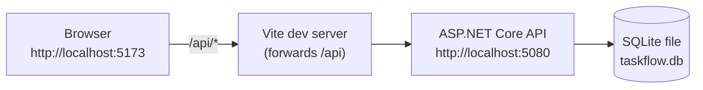

# Architecture overview (for README.md)

> Story 1.1 copies this section into the root `README.md` as-is. The binding decisions are in [ARCHITECTURE-SPINE.md](ARCHITECTURE-SPINE.md).

## How TaskFlow is built

TaskFlow is a small full-stack app with two parts that run side by side on your machine:

- **Backend:** an ASP.NET Core Web API in C# (.NET 10). It owns all the data and every rule.
- **Frontend:** a React + TypeScript app built with Vite. It shows the data and sends what you type to the API.



The browser only ever talks to the Vite dev server. Vite forwards every `/api/...` request to the API, so there is no cross-origin (CORS) setup and no HTTPS certificate to install.

### Inside the API: three layers

| Layer | What it does | Example |
| --- | --- | --- |
| **Controllers** | Receive HTTP requests and send responses. No rules here. | `TasksController` |
| **Services** | Check every input, apply the business rules, read and write data. | `TaskService` checks that a title is present and that the due date is not in the past |
| **Data** | Describes the tables and relationships for Entity Framework Core. | `TaskFlowDbContext`: deleting a project deletes its tasks |

Requests and responses use small **DTO** classes (data transfer objects), so the database entities never leak into the API.

### Rules the database and API enforce

- Every task belongs to an existing project. Deleting a project deletes its tasks. The **database** enforces this with a foreign-key cascade, not only the C# code.
- Status (`Todo`, `InProgress`, `Done`) and priority (`Low`, `Medium`, `High`) accept only these names, ignoring case. Numbers like `2` or `7` are rejected, both in request bodies and in URL filters.
- A due date can't be set in the past. "Today" comes from an injectable clock (`TimeProvider`), so tests can fix the date.
- Invalid input returns HTTP 400 with one message per field. The form shows each message next to its input.

### How it is tested

`dotnet test` starts the real API in memory and calls it over HTTP. Each test gets a fresh **SQLite in-memory** database, so foreign keys and cascade deletes behave exactly as they do in the real `taskflow.db` file. One extra test writes to a temporary database file, restarts the API, and checks the data is still there.

### Where things live

```text
backend/TaskFlow.Api/         API: Controllers/, Services/, Dtos/, Models/, Data/
backend/TaskFlow.Api.Tests/   xUnit integration tests
frontend/src/                 React: pages/, components/, api/ (the only code that calls the API)
```
